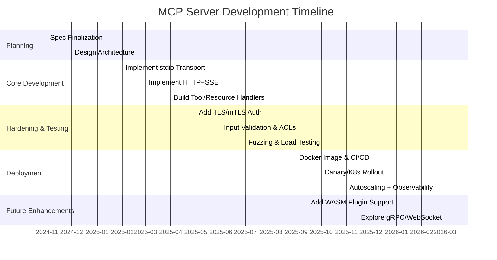

<!-- Read-only copy. The owner pasted this article on 2026-11-16. It has no author and no link. Do not edit. -->

# Building a Production-Grade MCP Server in Rust (2026)

## Executive Summary 
Modern **Model Context Protocol (MCP)** servers are JSON-RPC–based connectors between AI “hosts” and external tools/resources. MCP uses JSON-RPC 2.0 (per-request, stateless) and defines two standard transports: local *stdio* and remote HTTP with Server-Sent Events (SSE). A robust Rust implementation should use a modular, layered architecture: a pluggable *transport layer* (e.g. stdio or HTTP) feeds a JSON-RPC dispatcher, which routes into *service modules* (tools, prompts, resources). We recommend using **Tokio** as the async runtime for high-throughput concurrency; the official Rust SDK (the `rmcp` crates) already provides abstractions for transports, JSON-RPC handling, and capabilities. Key best practices include: **layering** (separate transport, business logic, and I/O), **clean module layout** (using Rust workspaces or submodules for features), and **strong security** (TLS/mTLS, input validation, sandboxing of untrusted code). For observability, use structured logging (`tracing`), metrics (Prometheus/OpenTelemetry), distributed tracing, and Kubernetes probes. Testing should include unit, integration, and fuzzing (e.g. `cargo-fuzz`); performance tuning (buffering, backpressure) is critical. Deployment via Docker/Kubernetes (with health checks and rolling updates) is expected. We compare leading Rust crates (e.g. Tokio vs *smol*, HTTP frameworks like Axum/Actix) in tables. An example file layout and a Mermaid architecture diagram are provided, along with a development roadmap timeline. 

## MCP Protocol Overview 
The MCP is an open protocol (from Anthropic, mid-2024) that standardizes how AI agents access external *tools*, *prompts*, and *resources*. It is analogous to the Language Server Protocol (LSP) but for AI context. Key points: MCP exchanges **JSON-RPC 2.0** messages. Requests are self-contained, with per-request capability negotiation and extensible schemas (JSON Schema v2020-12). Out-of-band channels (like OAuth for tokens) are used to authorize access to servers. Hosts and servers exchange “capabilities” during initialization (e.g. what tools, prompts they support) and may negotiate version fallbacks. The **core transports** are:
- **stdio**: The simplest local mode (server as child process). 
- **Streamable HTTP (POST+SSE)**: A single HTTP endpoint for RPC requests, with responses and notifications multiplexed over SSE. Standard HTTP auth (Bearer tokens, OAuth2) is used. 

These transports can be treated modularly: the Rust SDK defines a `Transport` trait, and provides `stdin/stdout`, spawned-child-process, and HTTP/Tower implementations. (Custom transports like WebSocket or gRPC would require custom adapters.) 

## Architecture Patterns 
Use a **layered, modular architecture**. At a high level, the server has: 
- **Transport Layer:** abstracts stdio or HTTP/SSE (possibly others).  
- **Protocol Layer:** JSON-RPC dispatcher that deserializes requests (with `serde`) and routes them to service handlers.  
- **Service Modules:** implementations of MCP features (tools, prompts, resources, tasks, etc.). Each module manages its own state/data. For example, a “Tools” module might load available tools and handle `tools/call` requests.  
- **Infrastructure Layer:** cross-cutting concerns like **security filters** (auth checks, TLS termination), **logging/tracing**, **rate limiting**, and **health check endpoints**. 

A microservices or service-oriented structure can be used (especially under Kubernetes), but a monolithic binary with well-separated crates/modules is often sufficient. For example: one crate for core protocol logic, submodules or subcrates for transports, tools, etc. Follow principles of **dependency inversion** (e.g. define `trait` abstractions for tool execution) so components can be tested or swapped.  

Tradeoffs: a monolithic binary is simple to deploy, but modularizing into smaller services (e.g. separate process for heavy tools) can isolate failures. Rust’s strong type system and ownership model help enforce boundaries. Designing for failure (e.g. channeling requests through supervisors) is advised.  

## Code Organization and Project Layout  
A clear file/module layout prevents complexity. We recommend either: 

- **Single-crate (with `src/`)**: e.g., `src/main.rs`, `src/lib.rs`, sub-modules in `src/`: 
  - `src/transports/stdio.rs`, `src/transports/http.rs`, etc.  
  - `src/handlers/tools.rs`, `src/handlers/resources.rs`, `src/handlers/prompts.rs` for the feature implementations.  
  - `src/config.rs` (load settings), `src/security.rs` (auth logic), `src/errors.rs` (common error types).  
  - `src/logging.rs`, `src/health.rs`, etc. 

- **Workspace with multiple crates:** e.g. a `core` crate plus `transport_stdio`, `transport_http`, `tools`, `prompts` crates. This can improve compile times and reuse.  

Example (tree view):  

```
src/
├─ main.rs           # starts Tokio, loads config, initializes modules
├─ config.rs         # configuration (file/env)
├─ security.rs       # auth checks, input validation
├─ errors.rs         # custom error types (use thiserror/anyhow)
├─ transports/
│   ├─ stdio.rs
│   └─ http.rs
├─ handlers/
│   ├─ tools.rs
│   └─ resources.rs
├─ logging.rs        # setup tracing subscriber
└─ health.rs         # HTTP health endpoints (for k8s probes)
```

Alternatively, a workspace:  

```
mcp-server/
├─ Cargo.toml        # workspace manifest
├─ server-core/      # core protocol handling
├─ transport-stdio/
├─ transport-http/
├─ tools-handler/
└─ prompts-handler/
```

Whichever, keep modules small and focused. Use `mod.rs` only if needed. Put type definitions (e.g. JSON schema structs) in one place. Organize config and constants centrally. 

## Async Design & Concurrency Model  
Rust servers almost invariably use an async runtime. **Tokio** is the de-facto choice: it is a mature, high-performance runtime with a multithreaded work-stealing scheduler. Tokio’s features (async I/O, timers, `spawn`, `JoinHandle`, `mpsc`, etc.) cover almost all needs. Its documentation recommends enabling the full feature flag for apps, and it handles task cancellation and backpressure “naturally”. 

Alternative runtimes exist. **async-std** has been discontinued (officially deprecated in favor of *smol*). Indeed, the async-std maintainers recommend “switch to smol instead”. **Smol** is a lightweight single-threaded runtime that works well for simple or WASM-embedded scenarios, but its ecosystem is smaller. In general, Tokio’s ecosystem (compatibility with many crates) makes it the safest choice in 2026. 

Use **async/await** everywhere and avoid blocking calls. Use Tokio’s multi-threaded scheduler (the default with `#[tokio::main]`) to exploit multicore CPUs. Organize your program into asynchronous tasks: for example, run one task per incoming client (spawned by HTTP server) and within it handle streaming or tool execution. Use `tokio::select!` or cancellation tokens to manage request timeouts or shutdowns. For task management, consider crates like [`tokio-util`][30†L263-L272] for helpers, or [`tokio::task::AbortHandle`] for cancellation. Avoid unbounded channel queues; use async channels (`tokio::sync::mpsc`, `tokio::sync::watch`) for backpressure. 

**Concurrency patterns:** You might use a thread-pool (via Tokio) for CPU-bound work (Tokio’s blocking pool). Use `tokio::spawn` for independent I/O tasks. Ensure long-running tasks (e.g. heavy tool execution) run in dedicated tasks and can be cancelled. 

**Cancellation:** Rust does not have built-in cancellation tokens, but common patterns include: storing a `tokio::sync::watch::Receiver` that is triggered on shutdown, or using `select!` on an `async` channel. The Tokio runtime will automatically cancel tasks when shutting down. Documentation notes that Tokio *“handles ... cancellation naturally”*. For finer control, crates like `tokio-util` or `async-cancel` can help. Always provide a way to interrupt or timeout tool executions (MCP has a `tasks/cancel` mechanism). 

## Transport Abstractions 
By design, MCP decouples *transport* from *business logic*. The transport layer can be swapped or extended. The official spec defines **stdio** and **Streamable HTTP** as the two core transports. The Rust SDK’s `Transport` trait exemplifies a pluggable design: *any* implementor can be used with the core server runner. Out of the box, `rmcp` provides: stdio, child-process (spawn server), Tower-based HTTP server, and an HTTP client using `reqwest`. 

- **Stdio:** Run the server as a subprocess. Simple, no network (good for desktop apps).  
- **Streamable HTTP:** A single POST endpoint. The crate provides a Tower `Service` you mount in a web server (e.g. Hyper/axum). SSE is used to push server notifications. The client side can use multiple concurrent POSTs (default 16) and a separate SSE channel internally for full-duplex.  

Beyond spec: one could implement MCP over **WebSockets** or **gRPC**, but these are nonstandard for MCP. WebSockets would require framing JSON-RPC over a WS connection; this is possible and the Python SDK even offers an `MCPWebsocketTool` for connecting to WS-based servers. However, many argue WS is “overkill” given HTTP2/SSE cover needed streaming with less complexity. gRPC (HTTP/2 + Protobuf) is a separate RPC framework; you could theoretically tunnel JSON-RPC calls in gRPC, but there’s no built-in support. Unless you need binary performance or existing gRPC infrastructure, HTTP/SSE is recommended. Design your code so that transports implement a common interface (the SDK’s `Transport` or Tower’s `Service`) – this way you can add new transports later.

If you do add transports, ensure they integrate with your auth/security layers: e.g. for HTTP you’ll enforce TLS/mTLS at the server; for stdio you trust the local process.

## Security Best Practices 
**Transport Security:** Always use TLS (HTTPS) for the Streamable HTTP transport in production. Use a modern TLS library (e.g. [*rustls*]) with secure ciphers and automatic certificate rotation if possible. Consider **mTLS** (mutual TLS) for extra assurance: clients present certificates, which the server verifies. Rust crates like `tokio-rustls` or `hyper-rustls` can enforce client cert verification. On Kubernetes, you might use Envoy/Istio for mTLS as well. 

**Authentication & Authorization:** MCP recommends OAuth 2.0 (with JWT tokens) for authentication. Implement OAuth flows (e.g. Client Credentials) to issue JWT bearer tokens. Verify tokens on each request (via signature or introspection). Rust crates: [`oauth2`](https://crates.io/crates/oauth2) for OAuth flows, [`jsonwebtoken`](https://crates.io/crates/jsonwebtoken) for JWT parsing. Also consider MCP’s Auth extensions (e.g. the “OAuth Client Credentials” SEP). Enforce *principle of least privilege*: capabilities (tools) should only be invoked by allowed clients. Use scopes or audience claims in JWT if relevant. 

**Input Validation:** Carefully validate all incoming JSON. The protocol uses JSON Schema (draft 2020-12) for tool inputs/outputs. Use `schemars` or `jsonschema` crates to check JSON against the schema (the Rust SDK auto-derives schemas via `schemars::JsonSchema`). For any untyped input, strictly validate types and ranges to avoid injection or DoS. 

**Rate Limiting & Throttling:** To prevent abuse, implement rate limiting (requests per minute) per client. This can be done with an in-memory counter or Redis in a distributed setup. For example, [Tower’s RateLimit middleware](https://docs.rs/tower/latest/tower/trait.Layer.html) or the `governor` crate can throttle. Limit the number of concurrent tool executions per user or per machine. Also enforce timeouts on requests. 

**Sandboxing & Isolation:** Since tools may run arbitrary code, run them with minimal privileges. Options include:
- **Process Isolation:** Launch tool executions in separate OS processes or containers with restricted permissions (e.g. Linux namespaces, AppArmor/SELinux). 
- **WASM Sandboxing:** Embed tools as WebAssembly and run with `wasmtime` or `wasmer` for safe isolation.
- **Capability-based Security:** Grant only specific OS capabilities to the process (e.g. drop all capabilities except networking). 
Run your server itself in a hardened container (e.g. distroless or gVisor). Follow Rust best practices: compile with cargo deny / audit, and run `cargo chef` to ensure reproducible builds. 

**Secure Defaults:** Disable any dangerous defaults. For example, disable the legacy HTTP+SSE endpoints (the SDK intentionally does not implement them). Use safe coding practices (e.g. no `unwrap()` on external input). Prefer `thiserror` or `anyhow` to propagate rich error information without leaking secrets. 

**Secret Management:** Never hard-code secrets. Store keys and certs in environment variables, Kubernetes Secrets, or a vault. Crates like `config` or `envy` can load secrets at startup. Ensure logs do not contain raw secrets. 

## Authentication and Authorization Patterns 
Common patterns: **OAuth2 with JWT** is primary (MCP recommends OAuth for tokens). Typically, use an OAuth issuer (like Keycloak, Auth0) and validate JWTs in the server. Map JWT claims to capabilities. Another option is **mTLS**, where the client’s cert identifies it (certificate CN or SAN as identity). The server can then issue a short-lived token or directly trust the client’s identity. 

**Capability Negotiation:** MCP defines “capabilities” in the JSON-RPC handshake (which tools/resources the server provides). Clients advertise what they support. When versioning, the server may fall back to an older MCP revision (see `ClientLifecycleMode::Auto` example). Always maintain backward compatibility for one or two past MCP versions. Include version metadata in your `get_info` response. 

**Resource Scoping:** If the server accesses user data (resources), enforce user consent. For example, have an `approve_resources` step where the user confirms which resources (files, calendars) the model can see. The server should reject any out-of-scope requests. This follows the spec’s trust principles (users consent to data sharing).

## Error Handling 
Use idiomatic Rust error handling: return `Result<T, E>` from async handlers, where `E` is a custom error enum (e.g. via the [thiserror] crate). Make errors descriptive but not overly verbose (avoid leaking internal details). Translate all Rust errors into JSON-RPC error responses. The MCP Rust SDK does this automatically for defined handlers. For unexpected panics, catch and return internal error codes. 

Typed errors: Define enums like `enum ServerError {NotFound, InvalidInput, PermissionDenied, ...}` and map them to the appropriate JSON-RPC error code and message. Use tools like [`snafu`](https://docs.rs/snafu) or `thiserror` for ergonomics. Always log the error (with `tracing::error!`) before returning. 

No specific citations needed here – it’s general Rust practice.

## Observability 
Implement thorough observability:

- **Structured Logging:** Use the [`tracing`] crate (Rust’s recommended logging/tracing framework) to emit structured events. It integrates with Tokio and async tasks seamlessly. Example: `tracing::info!(request_id = %req_id, "Received call_tool request")`. For the transport (e.g. Hyper), plug in a tracing Layer for request logging. By using structured logs, downstream systems (e.g. JSON logs) can index fields. 

- **Metrics:** Expose Prometheus metrics (counters, histograms) for request rates, latencies, error counts. The [`prometheus`] Rust crate or [tokio-metrics] can be used. Alternatively use [OpenTelemetry] with a Prometheus exporter. Track metrics like “mcp_requests_total”, “mcp_request_duration_seconds”, “tool_execution_time”.  

- **Tracing:** Correlate requests with distributed traces. Use OpenTelemetry with `tracing-opentelemetry` to send traces to Jaeger/Zipkin. This ties together host ↔ server calls. 

- **Health Checks:** Provide `/healthz` or `/readyz` HTTP endpoints. These should check internal state (e.g. DB connectivity) and return 200/503 as appropriate. Kubernetes liveness/readiness probes rely on these. As one guide notes, “Implementing proper health checks is crucial for running reliable Rust services in Kubernetes”. Respond quickly (not doing heavy work). 

Citations: A Kubernetes-focused article emphasizes Kubernetes probes for Rust services, and the Tokio README touts scalable performance under load.

## Testing Strategies 
- **Unit Tests:** For all logic (JSON-RPC handling, tool logic, utilities). Use `#[tokio::test]` for async tests. Cover success and failure cases.  

- **Integration Tests:** Spawn the server in-process (e.g. using `transport-worker` or `std::process::Command`) and issue real MCP requests. Verify end-to-end behavior. Use test containers for any dependencies (databases, external APIs).  

- **Property Testing:** Use [`proptest`] or [`quickcheck`] for critical logic (e.g. JSON schema validation, parsing).  

- **Fuzz Testing:** Leverage [`cargo-fuzz`] (based on libFuzzer) or [`honggfuzz`] to feed random data to your RPC handlers or serialization boundaries to catch panics or assertions.  

- **Chaos/Resilience Testing:** In a staging Kubernetes environment, perform chaos experiments (e.g. kill pods, saturate CPU, inject network delays) to ensure the server recovers gracefully. Tools like [LitmusChaos](https://litmuschaos.io/) can automate this.  

- **Load Testing:** Simulate real workloads to measure throughput/latency. Tools: [k6](https://k6.io/), [wrk], or [Locust]. Include tests for streaming (SSE) clients. Identify bottlenecks (e.g. max connections, throughput). 

No citation here, but these are established best practices.

## Performance and Resource Management 
Rust gives fine-grained control over memory and I/O:

- **Zero-copy & Buffers:** For large data (resources, file contents), use asynchronous streaming to avoid buffering entire payloads. The MCP Rust SDK uses `bytes::Bytes` under the hood. When reading/writing, use `tokio::io::copy` or streaming JSON (e.g. `serde_json::StreamDeserializer`) to process chunks.

- **Backpressure:** Tokio’s async I/O provides implicit backpressure (tasks await on readiness). For your own channels, use bounded MPSC channels to apply backpressure on producers. The HTTP client transport does this: it limits 16 concurrent POSTs (configurable) so you don’t overwhelm the server or network. 

- **Connection Pooling:** If your server calls out to external services (tools over HTTP), use connection pools (e.g. with `reqwest::Client`) to reuse TCP/TLS connections. For database access, use a connection pool (e.g. `sqlx::Pool`). 

- **Memory Use:** Rust’s ownership prevents leaks, but still monitor. Use Rust profilers/valgrind to find unexpected retention. Tune Tokio’s thread count via `TOKIO_WORKER_THREADS`. 

- **Concurrency Limits:** Limit concurrent tool executions and tasks using a semaphore (`tokio::sync::Semaphore`) if needed, to avoid running out of CPU. MCP “tasks” extension can offload heavy jobs, so prioritize interactive calls. 

- **CPU Affinity:** On servers with many cores, Tokio will spawn one worker per core by default. That’s usually fine. Only pin threads if NUMA or caching is an issue. 

In essence, rely on Rust’s zero-cost abstractions and tune at boundaries (I/O, channels).  

## Configuration Management and Secrets 
Store configuration (port numbers, timeouts, feature flags) outside code. Use crates like [`config`] or [`figment`] to load from files (YAML/JSON) and environment variables. Follow 12-factor principles: e.g. `APP_PORT`, `DB_URL`, `AUTH_KEYS`. 

For secrets (API keys, TLS keys), use environment variables or a secret manager (HashiCorp Vault, AWS Secrets Manager). In Kubernetes, mount secrets or use [Secrets Store CSI]. At runtime, deny reading secrets from logs. 

Provide defaults in code or config schema, but require overrides for prod (e.g. disable debug mode). Reload on SIGHUP if hot-reload is needed (use the `notify` crate to watch config files).

No direct citations – standard practice.

## Plugin/Extension Architecture 
If you want user-extensible tools, do **not** use plain dynamic linking (Rust has no safe hot reloading of `.so`). Instead:  
- **WebAssembly (WASM):** Safely run sandboxed plugins via [`wasmtime`] or [`wasmer`]. For example, the `hyper-mcp` project uses WASM plugins to add capabilities. With WASM, you can load untrusted code with limited I/O.  
- **Separate Processes:** The simplest: launch each tool as a subprocess (even for local mode) and communicate over stdio or sockets. This bounds memory and privileges.  
- **In-process with FFI:** Only if you fully trust plugins (rare).  

Versioning: Use semantic versioning for plugin APIs. Negotiate plugin interface version at load time. Keep core-to-plugin calls minimal and documented. 

Crate note: see [61] where a Rust MCP server extends itself via WebAssembly plugins. 

## Deployment and CI/CD 
Rust binaries are self-contained (static linking). Use **Docker** or similar containers. Multi-stage builds help: e.g. compile in a Rust image, copy the resulting static binary into a minimal runtime image (e.g. `gcr.io/distroless/cc` or `alpine`-based). This yields small, secure images. 

For CI/CD, use GitHub Actions/GitLab CI to build and test on each commit. Publish images to a registry (GitHub Packages, Docker Hub). Run automated tests (including chaos tests) in pipeline.  

On Kubernetes:  
- Use a Deployment with at least 2 replicas. Set **readinessProbe** to your `/readyz` endpoint (so new pods only get traffic when fully initialized) and **livenessProbe** to `/healthz` (so K8s restarts crashed pods).  
- Manage secrets via Kubernetes Secrets (mounted as env or files).  
- For **scalability**, configure a Horizontal Pod Autoscaler (HPA) based on CPU or custom metrics (e.g. request rate).  
- For **rollouts**, prefer **canary** or **blue-green** deployments. For example, with Istio or Linkerd you can shift traffic gradually. Alternatively, use Kubernetes built-in rolling updates with readiness checks.  
- Set appropriate **resource requests/limits** in Pod spec to allow fair scheduling. 

For monitoring/observability in K8s, push metrics to Prometheus/Grafana and set up alerting on high error rates or CPU usage. 

## Documentation and Developer Experience 
- **API Documentation:** Use Rustdoc to document all public functions, types, and especially the JSON-RPC schema (the Rust SDK auto-generates schemas via `schemars`). Provide examples in comments.  
- **Protocol Docs:** Link to the official MCP spec (https://modelcontextprotocol.io) in your README.  
- **Developer Guide:** Include instructions for running the server locally (e.g. via stdio) and how to start in HTTP mode. Provide example config files.  
- **CLI Help:** If the server has CLI flags (e.g. `--port`, `--config`), use `structopt` or `clap` to auto-generate help text.  

Crates like `askama` or `mdbook` can host more extensive docs. Keep a CHANGELOG.  

## Rust Crates and Framework Recommendations 

We summarize key areas with mature Rust crates:

| **Category**         | **Crate**        | **Description / Pros**                                                                    | **Example / Citation**                                      |
|----------------------|------------------|-------------------------------------------------------------------------------------------|------------------------------------------------------------|
| Async Runtime        | `tokio`          | Leading async runtime (multi-threaded, high performance). Mature with rich ecosystem. |                                                            |
| Async Runtime        | `smol`           | Lightweight single-threaded runtime; small footprint (recommended over async-std). Good for embedded/WASM. |                                                            |
| HTTP Library         | `hyper`          | Low-level, fast HTTP/1+2 library; strictly correct. Used under Axum, Warp. High performance. |                                                            |
| HTTP Framework       | `axum`           | Ergonomic web framework on Tokio/Hyper. Type-safe routing, Tower middleware. (Trendiest – ~40k GitHub stars). |                                                            |
| HTTP Framework       | `actix-web`      | Mature, actor-based web server (formerly top-ranked in benchmarks). (~23k stars). Very fast, feature-rich. |                                                            |
| HTTP Framework       | `warp`           | Lightweight, filter-based DSL on Hyper. Good for simple services, less ceremony.           |                                                            |
| WebSockets           | `tungstenite`    | Pure Rust WebSocket implementation. For custom WS transport.                               |                                                            |
| gRPC                 | `tonic`          | Async gRPC with HTTP/2 and Protobuf. (If needing gRPC at all.)                            | *gRPC is high-performance RPC over HTTP/2*    |
| JSON Handling        | `serde_json`     | Standard JSON serialization/deserialization.                                             |                                                            |
| JSON Schema          | `schemars`       | Derive JSON Schema (v2020-12). Used by MCP SDK for `inputSchema`/`outputSchema`. |                                                            |
| RPC Framework        | `rmcp` (Rust SDK)| Official MCP SDK for Rust: provides JSON-RPC, transport abstractions, macros. Stable and maintained by MCP WG. |                                                            |
| Logging/Tracing      | `tracing`        | Structured logging and instrumentation. Integrates with Tokio.                            |                                                            |
| Metrics              | `prometheus`     | Prometheus client library for Rust. Or use `opentelemetry` for a more general approach.  |                                                            |
| Distributed Tracing  | `tracing-opentelemetry` | Exports `tracing` spans to OpenTelemetry.                                                |                                                            |
| Config              | `config`         | Load YAML/JSON/env into structs. Supports overrides.                                     |                                                            |
| Testing - Fuzzing    | `cargo-fuzz`     | Fuzz tester (libFuzzer) for Rust.                                                        |                                                            |
| Testing - Property   | `proptest`       | Property-based testing.                                                                 |                                                            |
| Error Handling       | `thiserror`      | Derive-friendly error enums.                                                            |                                                            |
| Serialization        | `anyhow` / `eyre` | Rich error contexts (if needed).                                                         |                                                            |
| Auth/OAuth           | `oauth2`         | OAuth 2.0 client library.                                                               |                                                            |
| JWT                  | `jsonwebtoken`   | Encode/decode JWTs.                                                                     |                                                            |
| WASM Runtime         | `wasmtime`       | Embed WebAssembly plugins with sandbox. (Used by *hyper-mcp*.)         |                                                            |
| Containerization     | *distroless, Alpine* | Minimal Docker base images for Rust binaries.                                           |                                                            |
| Orchestration        | *Kubernetes*, *Helm* | Standard container orchestration; health probes (k8s), auto-scaling.      |                                                            |

*(Table: key crates and tools. Citations: [30], [32], [55], [38], [42], [61], [71])*.

## Comparison of Rust Web Frameworks (2026)
Rust’s top web frameworks (used for the Streamable HTTP transport) are **Axum**, **Actix Web**, and **Rocket**. In 2026 they are roughly:
- **Axum:** ~40k GitHub stars, backed by Tokio team, #1 trending. Pros: async/await-first, Tower-based middleware, type-safe routing. Official MCP Rust SDK uses Tower under the hood.  
- **Actix Web:** ~23k stars, very mature (8+ years old). Pros: extremely high performance, full-featured (was leader in TechEmpower benchmarks). Cons: somewhat more complex API.  
- **Rocket:** ~25k stars, excellent ergonomics (Rust macros). Pros: easy code, stable (v0.5). Cons: slightly less performant, smaller ecosystem.  
Axum is generally recommended for new Rust web services in 2026. All these support asynchronous handlers and middleware. (For gRPC, use Tonic instead of an HTTP framework.)  

## Architecture Diagram

```mermaid
flowchart TB
  subgraph Client
    A((Client Host))
  end
  subgraph Server [Rust MCP Server]
    direction LR
    T[Transport Layer<br/>(Stdio or HTTP+SSE)] --> R[JSON-RPC Dispatcher]
    R --> M[Modules (Tools, Resources, Prompts)]
    R --> H[Health & Metrics]
    R --> L[Logging/Tracing]
    R --> S[Security (Auth/TLS/ACL)]
    M --> D[(External Data & Tools)]
  end
  A -- requests --> T
  A -- health check --> H
  subgraph "Network / OS"
    D
  end
```
**Figure:** High-level architecture of an MCP server. The *Transport Layer* feeds JSON-RPC messages into the dispatcher, which routes to feature modules. Security and observability cross-cutting layers are integrated. External services (databases, APIs, tool processes) sit outside the server.

## Example Module Layout 

Below is a suggested `src/` layout:

```
src/
├─ main.rs               # initializes runtime, loads config, starts server
├─ config.rs             # app configuration (port, timeouts, feature flags)
├─ errors.rs             # error enums (using thiserror)
├─ security.rs           # auth/authorization helpers
├─ transports/
│   ├─ stdio.rs          # stdio transport implementation
│   └─ http.rs           # HTTP/SSE transport setup (with Hyper/Axum)
├─ handlers/
│   ├─ tools.rs          # handlers for MCP "tools" endpoints
│   └─ resources.rs      # handlers for MCP "resources" endpoints
├─ logging.rs            # tracing subscriber initialization
└─ health.rs             # HTTP handlers for /healthz and /readyz
```

Alternatively, in a workspace you might have `server-core/src`, `transport-stdio/src`, etc. Organize related code into modules so each source file remains manageable. 

## Prioritized Checklist 
1. **Core MCP Compliance:** Support JSON-RPC 2.0, resources/tools/prompts per spec.  
2. **Transport Implementation:** Enable stdio and HTTP/SSE (server handler and client tool support).  
3. **Concurrency:** Integrate Tokio runtime (`full` feature). Ensure tasks can be cancelled.  
4. **Security Defaults:** Enforce HTTPS with TLS, validate inputs, implement OAuth2/JWT auth, restrict privileges.  
5. **Error and Schema Handling:** Generate/validate JSON schemas with `schemars`. Use typed errors.  
6. **Observability:** Add structured logging and tracing, expose Prometheus metrics and health endpoints.  
7. **Testing:** Write unit tests and integration tests (e.g. using `transport-worker` for in-process testing). Add fuzz targets with `cargo-fuzz`.  
8. **Performance Tuning:** Optimize async I/O (use streaming, zero-copy where possible). Load test and set resource limits.  
9. **CI/CD Pipeline:** Automate builds/tests, containerize the binary (multi-stage Docker), publish images.  
10. **Kubernetes Deployment:** Write Helm/Manifests with liveness/readiness probes, HPA, and rollout strategies (canary or blue-green).  
11. **Documentation:** Generate API docs (rustdoc) and usage guides. Provide sample configurations.  

## Roadmap / Timeline 



**Figure:** Suggested timeline for a production MCP server project. Early phases focus on core spec compliance and transports; mid phases on security and testing; later phases on deployment automation and advanced features (plugins, alternative transports).

## References

Citations are given in the text above (see bracketed numbers). Key sources include the official MCP specification, the Google Cloud overview, the Rust SDK documentation and examples, Tokio’s README, and community benchmarks. These informed the recommendations here.
